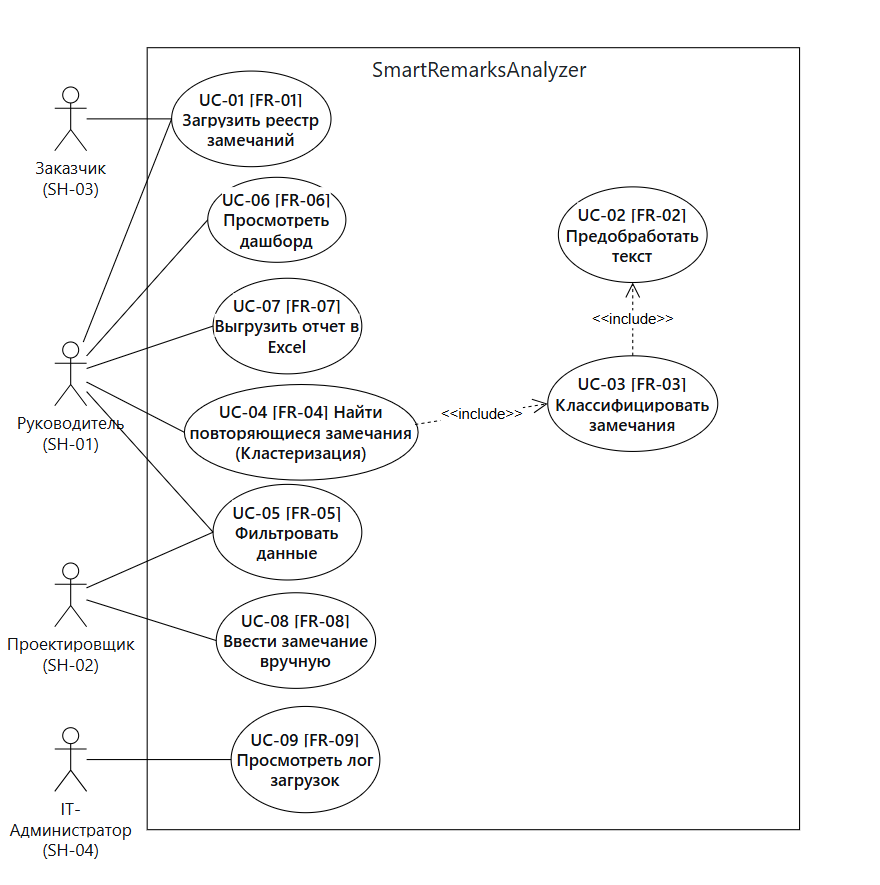

# Лабораторная работа №1. Формулирование требований к программной системе

| Поле | Значение |
|---|---|
| **Студент** | Алиева Самира |
| **Группа** | RIS-23-2 |
| **Вариант** | Разработка информационной системы для выявления повторяющихся замечаний заказчика на основе NLP |
| **Постановка задачи** | Тема ВКР |
| **Репозиторий** | https://github.com/alieva99/SmartRemarksAnalyzer |
| **Дата сдачи** | 24.11.2026 |

**Тема:** Анализ предметной области и формулирование требований к программной системе.

**Цель работы:** Научиться анализировать поставленную задачу, выделять заинтересованных лиц, формулировать функциональные и нефункциональные требования, представлять результаты в виде диаграммы вариантов использования.

---

## Краткое описание системы

Система представляет собой веб-приложение для автоматизации анализа замечаний заказчика в инженерных и строительных проектах. Программа собирает неструктурированные тексты замечаний из загруженных реестров, использует методы NLP (обработка естественного языка) для классификации и семантической кластеризации. Главная цель — предоставить руководителям удобный дашборд для выявления повторяющихся проблем (root causes) и снижения трудозатрат на ручной разбор документации.

---

## Оглавление

1. [Стейкхолдеры](#1-перечень-заинтересованных-лиц-стейкхолдеров)
2. [Функциональные требования](#2-перечень-функциональных-требований)
3. [Диаграмма вариантов использования](#3-диаграмма-вариантов-использования)
4. [Предположения](#4-перечень-сделанных-предположений)
5. [Нефункциональные требования](#5-перечень-нефункциональных-требований-повышенная-сложность)
6. [Чек-лист самопроверки](#6-чек-лист-самопроверки)

---

## 1. Перечень заинтересованных лиц (стейкхолдеров)

В системе выделено 4 ключевых стейкхолдера, включая одного внешнего (Заказчик), так как он является источником данных.

| ID | Стейкхолдер | Роль | Интересы / цели | Влияние |
|----|-------------|------|-----------------|---------|
| SH-01 | Руководитель проекта (ГИП) | Основной пользователь | Получать сводную аналитику по повторяющимся замечаниям для снижения трудозатрат | Высокое (принимает решения) |
| SH-02 | Инженер-проектировщик | Пользователь | Быстро находить ранее выданные замечания по своей теме, чтобы не повторять ошибки | Среднее (пользуется ежедневно) |
| SH-03 | Заказчик | Внешний стейкхолдер | Получать качественную документацию с минимальным количеством ошибок и итераций правок | Среднее (влияет на приемку) |
| SH-04 | IT-администратор | Технический персонал | Обеспечивать стабильную работу системы, следить за обновлением базы и безопасностью | Низкое (обслуживание) |

---

## 2. Перечень функциональных требований

Требования сформулированы по принципу MoSCoW. Приоритет Must отдан функциям, без которых невозможно решить главную бизнес-проблему.

| ID | Требование | Стейкхолдер | Приоритет (MoSCoW) | Обоснование |
|----|------------|-------------|---------------------|-------------|
| FR-01 | Система должна автоматически извлекать данные о замечаниях (текст, автор, дата, тип замечания, проект, заказчик, статус) из загруженного реестра. | SH-01 | Must | Без полного набора атрибутов невозможна дальнейшая фильтрация и аналитика. |
| FR-02 | Система должна очищать текст от «шума» (спецсимволы, лишние пробелы) и выполнять лемматизацию русского языка. | SH-01 | Must | Необходимо для корректной работы NLP-моделей. |
| FR-03 | Система должна автоматически классифицировать замечания по 5 заданным типам (оформление, коллизии и т.д.). | SH-01, SH-02 | Must | Позволяет отделить критичные ошибки от косметических. |
| FR-04 | Система должна находить повторяющиеся замечания (семантические дубли) и группировать их в кластеры. | SH-01 | Must | Ядро системы, решает главную боль бизнеса. |
| FR-05 | Пользователь должен иметь возможность фильтровать результаты анализа по проекту, отделу и типу замечания. | SH-01, SH-02 | Should | Ускоряет поиск нужной информации. |
| FR-06 | Система должна визуализировать топ-10 групп повторяющихся замечаний с указанием частоты. | SH-01 | Must | Главный результат для руководителя на дашборде. |
| FR-07 | Пользователь должен иметь возможность выгружать отчет с результатами анализа в формат Excel. | SH-01 | Should | Для подготовки к совещаниям и отчетам. |
| FR-08 | Система должна обеспечивать ручной ввод замечания, если автоматический парсинг не сработал. | SH-02 | Could | Резервный вариант для редких форматов данных. |
| FR-09 | Система должна сохранять историю загрузок файлов (лог). | SH-04 | Could | Для аудита и отладки. |

---

## 3. Диаграмма вариантов использования

**Связь с требованиями:** ID соответствующего FR указан в названии Use Case (например, `UC-03 [FR-03]`). Для построения использовался инструмент draw.io.

### Диаграмма

*(Примечание: исходник диаграммы находится в этой же папке в формате .drawio)*

### Описание ключевого сценария

| Поле | Значение |
|---|---|
| **Use Case** | UC-04 [FR-04] Найти повторяющиеся замечания (Кластеризация) |
| **Актор** | Руководитель (SH-01) |
| **Предусловие** | Файл с реестром замечаний успешно загружен в систему и сохранен в базе данных (UC-01). |
| **Основной поток** | 1. Руководитель нажимает кнопку «Запустить семантический анализ» на дашборде. 2. Система автоматически выполняет предобработку текста (include UC-02) и классификацию (include UC-03). 3. Система сравнивает векторы замечаний в базе с помощью алгоритма HDBSCAN. 4. Система группирует похожие замечания в кластеры. 5. Система сохраняет результаты и выводит уведомление об успехе. |
| **Постусловие** | Сформированы группы замечаний, данные визуализированы на дашборде (UC-06). |
| **Альтернативный поток** | Если в базе менее 2 замечаний, система выводит сообщение «Недостаточно данных для поиска дублей» и прерывает процесс. |

---

## 4. Перечень сделанных предположений

В ходе анализа были сделаны следующие допущения, так как они не оговорены в постановке задачи явно:

| ID | Предположение | Влияние на требования |
|----|---------------|-----------------------|
| A-01 | В MVP используются только текстовые данные. Замечания, представленные только в виде картинок (сканы), игнорируются. | Исключает необходимость внедрения OCR (распознавания текста) в требования. |
| A-02 | Данные для обучения классификатора уже размечены в реестрах (тип замечания указан цифрой от 1 до 5). | Позволяет использовать обучение с учителем (Supervised Learning) вместо сложных LLM. |
| A-03 | Система разворачивается локально на сервере компании (On-Premise), а не в облаке. | Влияет на NFR по Security (не нужен доступ извне) и выбор БД (PostgreSQL/SQLite). |
| A-04 | Пользователи работают с системой через веб-браузер (десктопные приложения не нужны). | Влияет на NFR Usability и выбор фреймворка (Streamlit). |

---

## 5. Перечень нефункциональных требований (повышенная сложность)

Из множества возможных NFR были выбраны 5 наиболее значимых для успеха проекта. Остальные (например, масштабируемость до миллионов пользователей) отброшены как избыточные для MVP.

| ID | Категория | Требование | Метрика / критерий приёмки | Почему выбрано |
|----|-----------|------------|----------------------------|----------------|
| NFR-01 | Performance | Время обработки и кластеризации замечаний. | ≤ 10 секунд на обработку 1000 строк | Руководители не должны ждать. Кластеризация HDBSCAN должна работать быстро. |
| NFR-02 | Usability | Интерфейс дашборда должен быть интуитивно понятен. | 90% пользователей выполняют базовый сценарий (загрузка -> просмотр) без инструкции | Главные пользователи — инженеры, а не IT-специалисты. |
| NFR-03 | Security | Защита данных, так как замечания содержат коммерческую тайну. | Шифрование данных при передаче (HTTPS/TLS). | Защита интеллектуальной собственности компании. |
| NFR-04 | Scalability | Система должна справляться с ростом базы данных. | Увеличение объема данных в 5 раз не приводит к деградации времени отклика более чем на 20%. | Компания накапливает данные годами (5000+ строк в год). |
| NFR-05 | Maintainability | Возможность быстрой замены NLP-модели на более новую. | Модульная архитектура, модели вынесены в отдельные конфигурационные файлы | Для быстрого обновления без переписывания всего бэкенда. |

---

## 6. Чек-лист самопроверки

- [x] README содержит ФИО, группу, вариант, постановку
- [x] Все таблицы имеют ID (SH-, FR-, A-, NFR-)
- [x] Каждое FR привязано хотя бы к одному стейкхолдеру
- [x] Каждый Use Case на диаграмме соответствует FR
- [x] Есть минимум один внешний стейкхолдер (SH-03)
- [x] NFR измеримы (числа, проценты, сроки)
- [x] Исходник диаграммы закоммичен (приложен .drawio и .png)
- [x] Нет требований вида «система должна быть удобной/надёжной» без метрики
