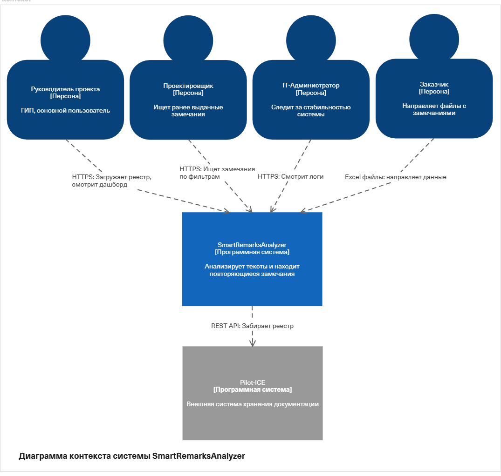
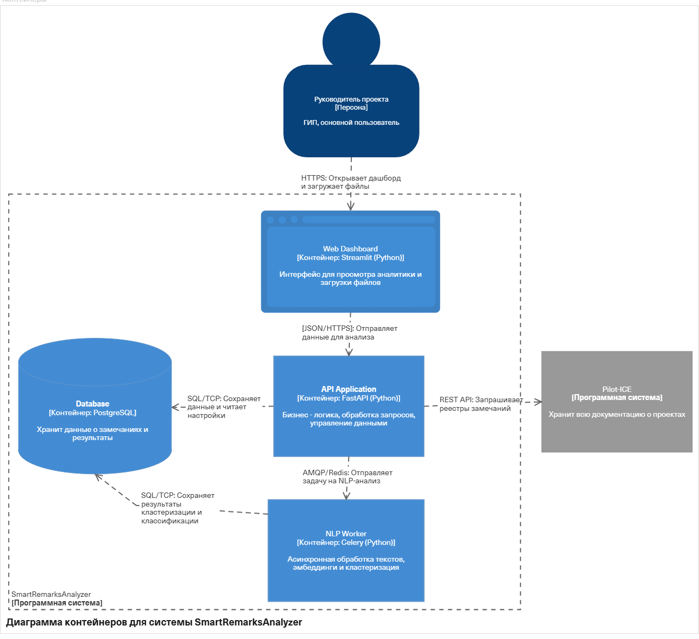
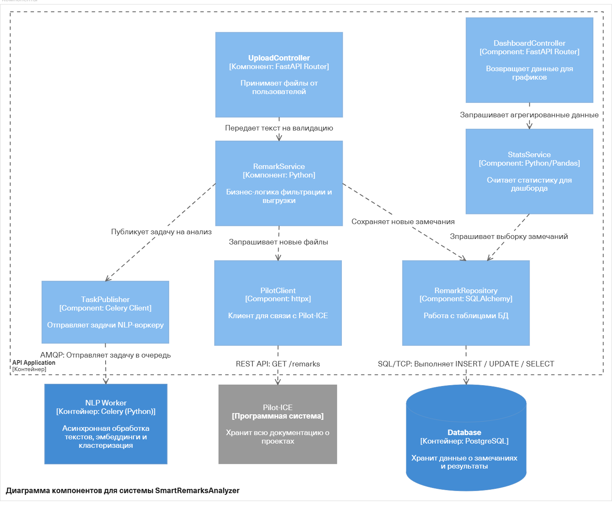
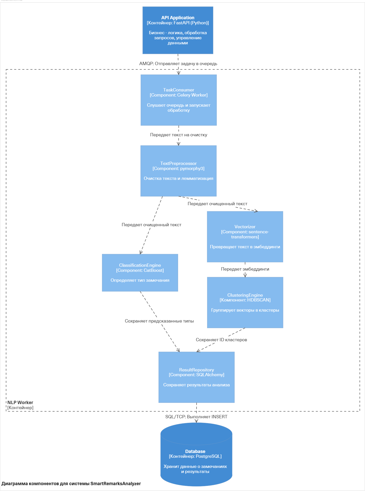

# Лабораторная работа №2. C4 model для проектирования архитектуры программной системы

## Титульный блок

| Поле | Значение |
|---|---|
| **Студент** | Алиева Самира |
| **Группа** | RIS-23-2 |
| **Вариант** | Разработка информационной системы для выявления повторяющихся замечаний заказчиков инжиниринговой компании на основе NLP |
| **Ссылка на ЛР №1** | [LAB_1_REPORT.md](../../Lab%20Work%20%E2%84%961/docs/LAB_1_REPORT.md) |
| **Репозиторий** | https://github.com/alieva99/SmartRemarksAnalyzer |
| **Инструмент диаграмм** | unidraw.io |

**Тема:** Использование нотации C4 model для проектирования архитектуры программной системы.

**Цель:** Получить опыт использования графической нотации для фиксации архитектурных решений.

---

## Краткое описание системы

Система SmartRemarksAnalyzer представляет собой веб-приложение для автоматизации анализа замечаний заказчика в инженерных проектах. Программа собирает тексты замечаний, использует NLP для классификации и семантической кластеризации (поиска дублей), и предоставляет руководителям удобный дашборд.

**Ключевые NFR из ЛР №1, влияющие на архитектуру:** NFR-01 (Performance — быстрая обработка), NFR-04 (Scalability — рост базы данных), NFR-05 (Maintainability — возможность обновления NLP-моделей).

---

## Оглавление

1. [Диаграмма системного контекста](#1-диаграмма-системного-контекста)
2. [Диаграмма контейнеров](#2-диаграмма-контейнеров)
3. [Диаграмма компонентов](#3-диаграмма-компонентов)
4. [Компоненты второго контейнера](#4-компоненты-второго-контейнера)

---

## 1. Диаграмма системного контекста

На диаграмме отображена проектируемая система, её пользователи (акторы) и внешняя система, из которой поступают данные.

### Диаграмма

### Описание элементов

| Элемент | Тип | Назначение |
|---|---|---|
| Руководитель проекта (ГИП) | Person | Загружает данные, просматривает аналитику |
| Проектировщик | Person | Ищет информацию по замечаниям |
| IT-Администратор | Person | Следит за работой системы |
| Заказчик | Person | Источник замечаний (присылает файлы) |
| SmartRemarksAnalyzer | System | Анализ и кластеризация замечаний |
| Pilot-ICE | External System | Система, откуда выгружаются реестры |

### Внешние интеграции

| Внешняя система | Протокол | Назначение |
|---|---|---|
| Pilot-ICE | REST API / HTTPS | Автоматическое получение файлов с замечаниями |

---

## 2. Диаграмма контейнеров

Система разбита на отдельные развертываемые единицы для обеспечения масштабируемости (NFR-04) и производительности (NFR-01). Тяжелые ML-задачи вынесены в отдельный фоновый сервис.

### Диаграмма

### Описание контейнеров

| Контейнер | Тип | Технология | Назначение | Какие FR покрывает |
|---|---|---|---|---|
| Web Dashboard | Container | Python / Streamlit | UI для пользователей, отображение графиков | FR-05, FR-06, FR-07 |
| API Application | Container | Python / FastAPI | Бизнес-логика, REST API, управление данными | FR-01, FR-05, FR-07 |
| NLP Worker | Container | Python / Celery | Асинхронный запуск NLP-моделей и кластеризации | FR-02, FR-03, FR-04 |
| Database | Database | PostgreSQL 15 | Хранение реестров, векторов и результатов | — |

### Выбор архитектурного стиля — сравнение

Выбран **сервисно-ориентированный стиль (Service-based architecture)** с элементами событийно-ориентированной архитектуры. 
*Почему:* Нам нужно разделить быстрый веб-интерфейс и тяжелые вычисления NLP (кластеризация может занимать секунды). Если мы будем делать всё в одном монолите, веб-интерфейс будет "зависать" при обработке новых данных, что нарушит NFR-01 и NFR-02. Вынос NLP в отдельный Worker позволяет масштабировать вычисления независимо. Монолитная архитектура была отклонена из-за сложности масштабирования тяжелых ML-задач. Микросервисы отклонены как избыточно сложные для MVP.

---

## 3. Диаграмма компонентов (контейнер `API Application`)

Выбран контейнер API, так как он является центральным узлом, связывающим пользователя, базу данных и NLP-воркер.

### Диаграмма

### Описание компонентов

| Компонент | Роль | Технология | Покрываемые FR |
|---|---|---|---|
| DashboardController | Controller | FastAPI Router | FR-05, FR-06 |
| UploadController | Controller | FastAPI Router | FR-01, FR-08 |
| RemarkService | Application Service | Python | FR-05, FR-07 |
| StatsService | Domain Service | Python / pandas | FR-06 |
| RemarkRepository | Repository | SQLAlchemy | — |
| PilotIntegrationClient | Integration | httpx | — |
| TaskPublisher | Integration | Celery Client | FR-02, FR-03, FR-04 (запуск) |

---

## 4. Компоненты второго контейнера (контейнер `NLP Worker`)

Выбран NLP Worker, так как он реализует ядро системы — машинное обучение, и имеет совершенно другую архитектуру (событийно-ориентированную).

### Диаграмма

### Описание компонентов

| Компонент | Роль | Технология | Покрываемые FR |
|---|---|---|---|
| TaskConsumer | Message Consumer | Celery Worker | FR-02, FR-03, FR-04 |
| TextPreprocessor | Domain Service | pymorphy3, razdel | FR-02 |
| Vectorizer | Domain Service | sentence-transformers | FR-04 |
| ClusteringEngine | Domain Service | scikit-learn, hdbscan | FR-04 |
| ClassificationEngine | Domain Service | CatBoost | FR-03 |
| ResultRepository | Repository | SQLAlchemy | — |
